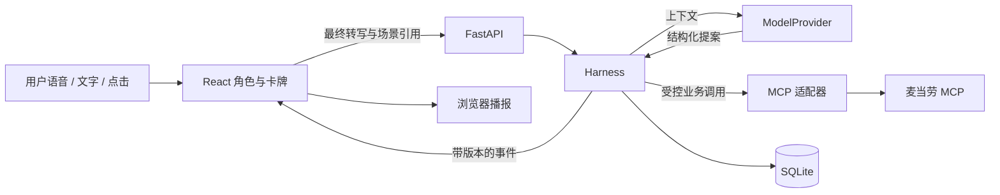

# 麦门战争 V1：对话式抽卡餐桌

版本：2026-10-17。本文是实施方案；“当前实现”以文末状态表和仓库代码为准。

接手研发时优先阅读 [HANDOFF.md](HANDOFF.md)，其中记录当前源码边界、24 项测试基线、MCP 实测状态和具体后续任务。

## 1. 产品定义

一句话：**和一个有性格的虚拟店员聊天，把能点的餐单抽成卡，再聊着改成自己喜欢的一餐。**

首批用户是喜欢麦当劳的学生和上班族，尤其是想保留一个喜欢的单品、又愿意给剩下的搭配一点惊喜的人。复用价值来自熟悉的角色、随口修改和自己的收藏；抽卡负责让选择过程有趣。

V1 采用一个主场景“对话餐桌”，附一个收藏抽屉。先完成从开聊、翻卡、改卡到收藏和确认的完整体验。原设想中的商店、门店打卡、论坛可以后续接入，但不会与当前主流程同时铺开。

项目名暂沿用“麦门战争”，实际功能围绕对话与卡牌编排。角色资源使用单独的素材适配层：先用原创或有明确使用权的 2D 店员素材；如使用具体麦当劳吉祥物，再记录素材来源与可用范围。

## 2. 用户看到什么

### 2.1 一次完整使用

1. 用户选择门店和就餐方式，说：“今天预算 30，给我抽三套，饮料不要含糖的。”
2. 店员回应已理解的条件；后端根据门店菜单、套餐替换规则和可用券生成候选，真实计价通过后展示最多三张卡。数量不足时显示真实可行数量。
3. 用户说：“第二张。汉堡留下，其他换一换。”选中的汉堡被锁住，其他部分重抽。新卡只改变允许修改的部分。
4. 用户看着卡说：“还是刚才那套，饮料换无糖。”恢复相应餐单内容并重新验证、计价，角色说明本次变化。
5. 用户说：“存成周五快乐餐。”收藏餐单配方和用户给的名字。以后打开收藏，可在当前门店重新匹配并计价。
6. 如需购买，界面展示最新餐单、门店、就餐方式与应付金额，用户明确确认后才创建订单；支付在 MCP 返回的官方支付入口完成。

上面是目标流程。目前脚本只实现“选第二张 / 饮料换无糖 / 撤回上一步”等有限步骤，预算筛选、锁定重抽与真实下单还未实现。

### 2.2 卡牌既是游戏内容，也是操作对象

餐单卡显示餐品组成、适用门店、报价状态、选择理由，以及替换/锁定/收藏按钮。翻卡动画在可信候选准备好后触发；查询期间展示等待状态。

收藏有清晰含义：“收藏的配方”“官方订单记录”“我标记吃过”分别记录。免费翻卡和收藏不要求消费，不将浏览或下单当成已经吃过。V1 不调用账户积分抽奖工具。

重抽只在可行候选内进行，先排除违反明确条件的组合，再按偏好和组合差异排序，通过带种子的加权采样增加变化。记录种子、候选集和规则版本，使演示可复现。候选不足就解释缺少什么条件，不偷偷放宽用户的硬限制。

营养字段必须能与真实餐品、规格对应；缺失时展示未知。V1 不把“同类餐品”估算值写成确定营养值。任何“最便宜”的承诺都需要覆盖范围证明，默认只说“本次比较的候选中价格较低”。

## 3. 最终产出与运行方式

交付为一个公开 GitHub 项目，包含：本地网页、Python 后端、可复用的业务核心、Skill 入口、测试与演示资料。采用本地启动，无需先购买云服务器。

浏览器运行界面和语音 API；后端持有配置并连接模型和麦当劳 MCP。Skill 是支持该工作流的宿主入口，MCP 是获取业务能力的协议。独立网页不会自动继承开发宿主的模型能力。

运行模式明确区分：

| 模式 | 数据与模型 | 用途 |
| --- | --- | --- |
| `demo` | 虚构 fixtures + 有限脚本 | 当前已实现，断网可运行核心流程 |
| `replay` | 脱敏录制的工具结果 + 已保存操作 | 计划实现，用于演示与回归；不能据此真实下单 |
| `live` | 真实 MCP + 用户选择的模型服务 | 计划实现，体验实际菜单、报价和确认下单 |

当前 SQLite 的“回放”是状态快照日志恢复，不等于上表尚未实现的工具录制回放模式。模式不能在接口失败时静默切换；界面持续标明数据来源。

## 4. 技术选型

| 层 | 选择 | 作用与边界 |
| --- | --- | --- |
| 前端 | React + TypeScript + Vite | 角色、卡牌、对话、收藏；用明确状态渲染 UI |
| 角色与翻卡 | CSS / Web Animations + 2D 素材 | 等待、倾听、思考、说话、翻卡几个状态；优先保证节奏和可打断性 |
| 语音输入 | Web Speech `SpeechRecognition` | 浏览器能力检测、中文识别、错误处理与文字替代 |
| 语音输出 | Web Speech `speechSynthesis` | 使用设备提供的声音，开始/结束事件驱动角色状态 |
| 本地服务 | Python 3.12 + FastAPI + Pydantic | HTTP 命令入口、WebSocket 事件、参数校验与任务管理 |
| Agent | 单 Agent + `ModelProvider` 接口 | 理解用户、产生结构化提案、组织回应；模型厂商待定 |
| Harness | 自建 Python 状态机与执行层 | 所有状态变更、工具权限、版本检查、预算和恢复逻辑 |
| MCP 客户端 | 官方 MCP Python SDK，Streamable HTTP | 服务发现、实际 schema 适配、调用与错误处理 |
| 数据库 | SQLite + 版本化 SQL 迁移 | 会话、收藏、报价证据、事件、订单尝试；先用标准库 `sqlite3` |
| 测试 | 当前 `unittest`；网页阶段 Vitest + Playwright | 行为不变量、浏览器状态、端到端演示和故障注入 |

当前离线核心只用标准库。独立 MCP 探针已安装并验证 `mcp==2.3.0` 与 `httpx2==2.13.1`，依赖记录在 `requirements-mcp.lock.txt`；其他层依赖在对应阶段安装。MCP SDK 的接口版本要与所用文档一致，不能混用不同大版本的初始化方式。

初版一个 Agent 足够。专业能力来自运行时协议、可信数据、可恢复执行与评估；不需要为了展示而增加多个相互讨论的 Agent。



## 5. Agent 与 harness 如何配合

### 5.1 模型提出操作，执行器决定能否落地

模型输入包含最终转写、有限对话摘要、当前卡片的结构化描述、选中卡、可用动作和用户明确约束。输出使用限定 schema，例如：选择卡片、替换餐品、锁定槽位、重抽未锁定部分、撤回、收藏、请求澄清。

模型不直接执行任意工具名，不直接写 SQLite，也不生成有支付效力的价格。当前 `ModelProvider.propose()` 已定义，固定脚本实现只支持三种操作；未来加入真实模型时再扩展带判别字段的 Pydantic 联合类型。

每轮执行：输入 → 绑定场景与轮次 → 模型提案 → schema 校验 → 业务校验 → 受控调用 → 版本核对 → 原子提交 → 界面事件 → 播报。

模型可生成角色语气和简短解释；商品、价格、优惠等事实由执行结果填入。尚未确认的价格不能先被播报为成交金额。

### 5.2 指代绑定：理解“第二张”和“刚才那个”

计划中的每次输入携带 `turn_id`、`scene_revision`、当前排序下的 `card_ids`、选中对象和客户端操作编号。用户开始说话时冻结卡片顺序，按钮点击直接使用稳定卡 ID。

“第二张”对应那一刻的第二张；卡片刷新后收到旧模型结果，拒绝应用。模糊的“那个”若没有选中对象或唯一候选，就询问具体对象。历史指代只在保留的餐单版本中解析，不能让模型凭空恢复内容。

目前核心已实现轮次、场景版本、卡片 ID 顺序绑定、指代越界检查和重复提案拒绝。浏览器冻结场景、点击路径和更复杂的历史指代待实现。

### 5.3 让改口、报价和播报保持一致

每个模型结果、报价请求和待播报片段都关联轮次与餐单版本。编辑餐品、门店、就餐方式或优惠条件后，相关报价和确认失效。旧任务尽力取消，但即使网络任务取消失败，结果提交时仍必须重新校验版本。

当前原型已验证：用户修改后迟到的报价被丢弃；对同一餐单发出两次报价请求时，只有最新请求有资格生效；撤回恢复食物内容，但不复用旧价格与确认。

网页阶段补齐：立即停止旧 TTS、清理旧播报队列、处理 WebSocket 重连和旧事件、按会话串行提交结果。SQLite 连接不跨线程共享；异步网络调用在事务外执行，返回后短事务提交，并用版本条件检查竞争。

### 5.4 限制任务范围

计划默认每轮最多 2 次模型请求（含一次 schema 修复）、4 次新候选计价、8 次业务工具调用，总截止时间 30 秒。这些是待实测调整的应用预算，不是官方配额。初次加载门店、菜单和候选详情也计入预算，超出就分阶段继续，而不是无限尝试。

只读失败允许有限重试，次数计入总预算；用户打断、截止时间到达、无候选或身份失效都有明确结束状态。当前原型仅实现最多 8 个未完成报价请求和最多 20 步撤回历史，完整超时与重试策略待接入异步服务时实现。

### 5.5 下单确认与不确定结果

最终报价绑定账号作用域、门店、就餐方式、餐品规格和数量、券、餐单版本、查询时间与有效期。由后端计算指纹，模型不能修改。

V1 用独立确认按钮承接真实下单，确认绑定具体报价。用户在对话中说“就它了”可打开确认面板；随后任何修改都使此前确认失效。当前 CLI 仅模拟这个边界，没有 HTTP 身份校验或真实下单能力。

真实下单前先在 SQLite 记录操作尝试，再调用 `create-order`。如果超时后无法确认是否创建成功，状态变为 `unknown_outcome`，停止重复创建，通过官方订单查询核实；无法唯一匹配时交由用户核对。不会假设 MCP 支持幂等键，也不会宣称本地去重能保证远程只执行一次。

## 6. 多模态范围与语音实现

V1 的多模态体现在“语音 / 文字 / 点击”共享一个状态，角色、字幕和卡片根据同一结果更新。模型先接收文本与结构化场景，因此准确说法是**多模态交互应用**，还不能宣称模型具备原生实时音视频理解。

第一版采用按键说话，流程如下：

1. 点击语音按钮，停止当前 TTS，发送打断事件并捕获场景。
2. 临时识别结果只显示字幕；最终识别结果提交为用户输入。
3. 转写失败、不支持 API 或无法联网时保留文本输入和卡片按钮。
4. 后端完成可信状态更新后，再播放简短回应；用户可随时停播。

`continuous` 只控制识别结果的连续返回，不保证全双工对话。Web Speech 也不保证离线识别；部分浏览器会把音频发送给识别服务。目标浏览器和中文网络环境需要实测。语音合成可选的声音依赖设备，不能承诺免费的定制吉祥物音色。[MDN：语音识别](https://developer.mozilla.org/en-US/docs/Web/API/SpeechRecognition)、[语音合成](https://developer.mozilla.org/en-US/docs/Web/API/SpeechSynthesis)。

本地离线演示保证的是文本与核心流程。浏览器语音是否离线可用取决于实现和设备，不能作为演示前提。摄像头不进入 V1。

## 7. MCP 接入范围

以真实服务的 `tools/list` 和实际响应为 schema 依据；用户提供的工具清单用于能力规划，不能据此猜测参数名、套餐嵌套或券叠加规则。2026-10-17 已成功发现 35 个工具，并调用时间与营养查询；其他工具目前只获取了 schema，尚未完成业务联调。

| 阶段 | 工具 | 在产品中的作用 |
| --- | --- | --- |
| 门店与菜单 | `query-nearby-stores`、`query-meals`、`query-meal-detail` | 获取当前能点的卡牌原料和可替换关系 |
| 可用优惠与报价 | `query-store-coupons`、`calculate-price` | 对当前门店、用户与餐单计算可信价格 |
| 营养补充 | `list-nutrition-foods` | 用户需要时展示有匹配依据的营养信息 |
| 确认后的订单 | `create-order`、`query-order`、`order-list` | 创建、查询，以及处理创建结果不确定的情况 |
| 后续个人账户 | `query-my-account`、`mall-points-products`、`mall-product-detail` | 扩展收藏旁的会员与礼品区域 |

V1 优先到店场景。外送需要增加配送地址、门店、费用及个人信息处理，不与第一条链路同时开发。若用户未来需要领券、兑换、取消或官方抽奖，再分别增加对应的明确动作和确认流程。

缓存只加速查询：菜单可按门店和就餐方式短时缓存，候选仍需校验。报价失效策略是应用策略，不代表麦当劳保证某个价格保持 60 秒；下单前按实际接口要求复核。

完整接入状态见根目录 [MCP_INTEGRATION.md](../MCP_INTEGRATION.md)。

## 8. SQLite 与证据记录

当前已有三张表：`sessions` 保存当前状态，`events` 保存每次提交后的状态快照和操作记录，`schema_versions` 保存迁移版本。状态和事件在同一事务写入，更新时检查旧版本，防止并发覆盖。

当前 `replay()` 按连续版本读取最后一份已记录状态，是快照日志恢复。后续要比较 Agent 改进前后的行为，需要额外录制输入、工具结果、随机种子和规则版本，再运行同一执行器重算；这一层尚未实现。

网页与真实 MCP 阶段按查询需要增加下列表，而不急于提前拆空表：

| 数据 | 关键内容 |
| --- | --- |
| `messages` | 会话、轮次、输入来源、最终文本；原始音频默认不落盘 |
| `scenes` / `cards` | 场景版本、稳定卡 ID、排序、餐品引用、证据来源 |
| `draft_revisions` | 选中餐单、锁定部分、用户约束、父版本 |
| `quotes` / `tool_calls` | 报价作用域、过期时间、耗时、调用结果分类、脱敏证据 |
| `favorites` | 配方与来源；不把历史价格作为当前报价 |
| `order_attempts` | 确认版本、操作状态、官方订单引用、不确定结果 |

账号凭据保存在本机配置中，不写入会话、事件或浏览器包。真实日志默认不保存地址、电话和支付链接；提供会话删除与导出脱敏功能。初版本地服务绑定 `127.0.0.1`，限制来源，使用本地会话凭据；目前这些网络层措施尚未实现。公网部署和多用户账号管理另立范围。

## 9. 工程目录

当前已有：

```text
maimen-agent/
  README.md
  CONTEST_DECLARATION.md
  MCP_INTEGRATION.md
  mcp-config.example.json
  .env.example
  pyproject.toml
  docs/PLAN_V1.md
  docs/CONTEST_CHECKLIST.md
  skills/maimen-agent/SKILL.md
  maimen/
    harness.py
    providers.py
    fixtures.py
    store.py
    demo.py
    migrations/001_initial.sql
  tests/test_harness.py
```

后续已新增 `maimen/adapters/mcd.py`、`maimen/mcp_probe.py`、`maimen/configure.py`，用于真实 MCP 连接检查和本机配置。继续开发时再增加 `web/` 前端、`maimen/api/` 本地服务、真实模型适配器及 `evals/` 的脱敏场景。

## 10. 迭代顺序与完成标准

| 阶段 | 交付 | 完成标准 | 当前状态 |
| --- | --- | --- | --- |
| P0 | 核心协议和离线脚本 | 修改、撤回、迟到报价、恢复有可运行验证 | 已实现，19 项测试通过 |
| P1 | 本地网页与语音入口 | 角色、三张卡、文本流程、语音失败回退、收藏；fixture 范围明确 | 待开发 |
| P2 | 模型适配器 | 多种自然说法、模糊指代澄清、结构化输出；保留 fixture 模式 | 接口已预留，真实模型待选择 |
| P3 | 真实 MCP 只读链路 | 真实门店、菜单、套餐、券、计价；有脱敏调用证据 | 已配置 Token 并验证时间/营养查询；菜单报价待联调 |
| P4 | 确认下单 | 最新报价确认、单次尝试、未知结果恢复、官方支付入口 | 待开发 |
| P5 | 展示与参赛提交 | 可复现安装、演示录像、真实调用说明、公开仓库、报名 | 文档结构已准备，尚未提交 |

P1 的 UI 可在没有模型和 MCP 凭据时开发；P2 与 P3 的适配器独立。时间紧时优先做通“语音/文字 → 真实菜单抽卡 → 改卡 → 收藏”的闭环，真实下单可作为后续能力，但申报材料必须与实际范围一致。

## 11. 如何证明技术深度

演示先展示顺畅体验，再展示一次故障：模型正在解释第二张卡时，用户说“等等，饮料换无糖”；旧报价故意延迟返回，系统停掉旧播报、保留正确修改，只展示新报价。随后撤回，证明旧的确认不会随餐单内容一起复活。

评估重点是可观察结果：

- **任务完成率**：给定目标餐单，最后的 SKU、规格、数量与约束是否正确。
- **指代正确率**：固定场景、刷新场景、历史餐单和模糊表达分别统计。
- **状态一致性**：乱序报价、重复点击、刷新恢复、模型非法提案是否污染餐单。
- **调用与延迟**：记录每轮模型次数、MCP 次数、最终转写到首个可信卡片的 p50 / p95，而不是只报模型首字延迟。
- **可玩性和复用**：请学生及同事各试用，观察是否愿意收藏、下次是否打开收藏，以及有无被动画拖慢。

模型接入后准备不同用户自然表达的评估集，开发用例与验收用例分开。浏览器语音需要真实麦克风、设备和网络人工测试，不能由伪造浏览器识别事件替代。当前有 19 项离线核心测试和 5 项 MCP 探针边界测试，尚无浏览器或模型评估。

## 12. 比赛要求对应

官方将 Skill 的形式定义得很宽，包括应用、智能体和工作流；本地网页加后端符合这一产物方向。实际使用麦当劳 MCP、规定文件和公开仓库仍需落实；文件齐全不等于完成参赛资格核验。[活动规则](https://github.com/M-China/mcd-developer-innovation-challenge/blob/main/activityGuidelines.md)。

`CONTEST_DECLARATION.md` 使用官方原文。`MCP_INTEGRATION.md` 已记录基础真实查询及尚未完成的业务范围。没有使用 WorkBuddy，因此不生成虚构的 `workbuddy.md`。参赛状态集中记录在 [CONTEST_CHECKLIST.md](CONTEST_CHECKLIST.md)。

## 13. 技术资料

- [官方 MCP 接入指南](https://github.com/M-China/mcd-mcp-server)：服务与能力说明。
- [官方 MCP Python SDK](https://py.sdk.modelcontextprotocol.io/)：接入阶段按匹配版本实现客户端。
- [FastAPI](https://fastapi.tiangolo.com/) 与 [WebSocket 支持](https://fastapi.tiangolo.com/advanced/websockets/)：本地服务与事件连接。
- [React](https://react.dev/) 与 [Vite](https://vite.dev/guide/)：前端实现。
- [Python sqlite3](https://docs.python.org/3.12/library/sqlite3.html)：本地持久化。
