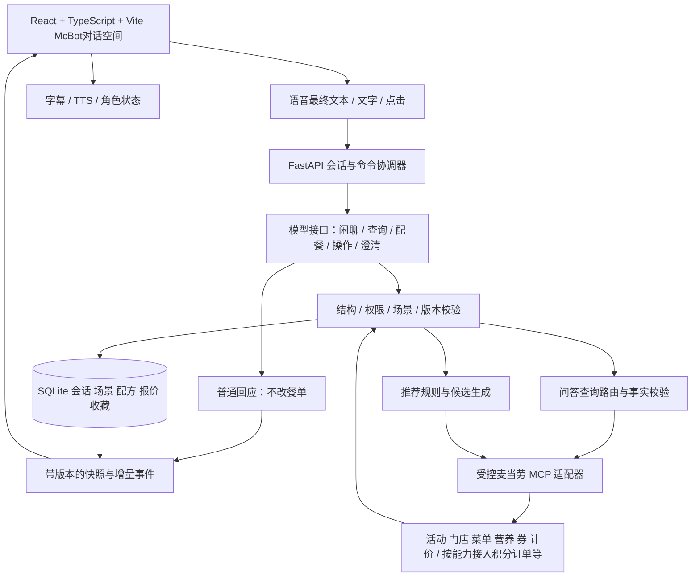

> 最新范围修正：不包含下单功能，也不作为后续待接入项。下文早期订单相关规划以此修正为准；动画与接入条件见 MCBOT_STATES.md。

# McBot：网页体验与系统架构

设计日期：2026-10-23。状态：设计提案，未搭建。以本次文件明确页面与后端的衔接；不将设计能力描述为现有功能。历史价格与70项测试记录来自10月17日，不代表今天重新验证。

## 1. 设计结论

2026-10-23用户最终确认：McBot是以自由对话为入口的麦当劳助手，首页使用用户已经设计好的活泼McBot角色，交流体验参考语音助手。用户可以通过语音或文字提出任何问题；系统按问题回答、查询或执行明确操作。三套餐单抽卡是其中一个能力，不能把所有问题转成点餐表单。

页面只保留一个主场景“McBot对话空间”，附三个抽屉：内容详情、我的收藏、门店与连接设置。角色始终是主角；对话按需展开新品、活动、营养、门店、优惠或三套餐单。权益信息放进设置和相关详情；对话历史可展开，不另建聊天页面。

“全知全能”是产品愿景，事实回答以MCP实际提供的数据及明确标注的知识来源为边界。MCP不等于麦当劳全部内部数据；缺数据时说明未知并给可行下一步，不能编造新品、价格、优惠或持卡状态。普通闲聊可由模型回答；涉及当前业务事实必须查询。首版不默认具有独立联网搜索能力。

默认本地运行、单人；真实配餐暂以立即到店自取为执行范围。全国活动或普通闲聊不要求先选门店，只有库存、价格、可用券等门店问题才补齐门店与渠道。完整设计覆盖后续订单闭环，但首个可用网页不展示未接通的支付按钮。外送、预约、团餐、多用户云账号按接通能力逐步开放；商城和积分问答可以纳入能力路由，兑换、订阅、领券、下单等写操作必须单独确认且实际接通。论坛、多人对战和摄像头不在当前范围。

## 2. 页面结构

| 区域 | 默认显示 | 展开或触发后 |
| --- | --- | --- |
| 顶部轻导航 | McBot、真实/演示标识、小图标入口 | 收藏、门店与渠道、连接设置；有门店任务时显示当前门店 |
| 动态助手舞台 | 角色、倾听/思考/说话状态、当前一句字幕 | 历史对话、静音、停止播报 |
| 需求条 | 配餐时才显示已确认预算、偏好与营养目标 | 点标签编辑或清除；更多条件折叠 |
| 回答展示区 | 默认收起；随回答展开摘要、单张信息卡或推荐卡组 | 内容详情、追问；餐单固定编号1/2/3，支持选中与修改 |
| 当前选择条 | 选中餐单摘要、修改中的状态 | 撤回、收藏；下单能力就绪后再显示确认入口 |
| 底部对话输入 | 文字框、麦克风按钮、发送 | 最终转写、明确的重试/取消 |

桌面初始状态突出居中的McBot、轻微待机动画和一句开场：“我是McBot，今天想聊点什么？”底部突出“开始语音”，旁边保留文字输入。可选三个漫画小标签：“最近上新”“今天怎么吃”“有什么优惠”。不预先铺满菜单、价格、三张空卡或预算表单，也不自动打开麦克风。

普通问答保持角色居中和简短字幕；出现可视内容时才展开下方内容台，宽屏可将角色移到左侧、内容放在右侧。只有配餐推荐才展开三卡餐桌，重抽仅更新卡组。收起内容可回到大角色对话，已有餐单继续保留；输入始终稳定在底部。

```text
┌ McBot · 真实模式                         收藏 / 历史 / 设置 ┐
│                                                           │
│                     活泼的 McBot                          │
│                     倾听 / 思考 / 回应                     │
│                   “今天想聊点什么？”                      │
│                                                           │
│          最近上新       今天怎么吃       有什么优惠          │
│          [按需展开：信息卡 / 新品 / 三套推荐餐单]             │
│  [ 和 McBot 说点什么……                         ] [语音][发送]│
└───────────────────────────────────────────────────────────┘
```

手机：助手在上方，出卡后收为小舞台；三张卡纵向排列并明确标号，保留“共3套”的提示。输入固定于安全区域，键盘弹出时缩小角色而不覆盖卡片操作。编号基于服务端场景顺序，不随滚动位置变化。详情、收藏、设置采用底部抽屉，不叠加多个弹层。

## 3. 视觉与角色

采用用户指定的麦当劳卡通与漫画方向：暖白背景、明黄与红色点缀、圆润描边、贴纸式图标、对话气泡和适量漫画动效。角色、功能图标、按钮、空状态、卡片装饰保持同一画风；不使用混杂的emoji代替图标体系。选中状态同时使用边框、勾选和文字，不只依赖颜色，避免装饰挤占角色和内容。

标题、短字幕、按钮和标签优先采用中文漫画字体；价格、数量、日期、营养表和长段说明使用协调的清晰正文/数字字体。字体缺字时回退，不牺牲中文可读性；具体字体随用户现有视觉素材确定。

用户已设计的McBot是角色基准，不重新选角色。实施时检查现有素材的格式、动画与状态映射，只补需要的状态，不把“形象已设计”误称为“全部动画已接通”。商品图来自真实菜单，放在漫画卡框内；卡通装饰不改变实际商品、规格和数量，不把一张单品图冒充整套。

角色状态：待机、倾听、处理、说话、需要澄清、暂不可用。状态来自真实事件，不用假进度条。失败时给短句和可操作按钮，不让角色无限思考。

翻卡只在结果可展示时触发一次；保留编号，最多三张。减少动画模式使用直接切换，仍显示处理状态。键盘可操作全部动作；抽屉关闭回到原焦点；操作目标不小于44px；字幕和错误文字对比度以4.5:1为实现验收目标。正常浏览不自动开启麦克风或有声播报。

## 4. 用户流程与操作语义

| 用户表达/操作 | 系统处理 | 用户看到的结果 |
| --- | --- | --- |
| “最近有什么上新？” | 查询当前活动信息，核对日期与明确的新品依据；需要购买时再查目标门店菜单 | 简短口头介绍与新品/活动卡；可接“用这个给我配三套” |
| “这个热量多少？” | 根据当前内容解析指代，准确匹配商品规格和营养来源 | 营养小卡；不自动开始配餐 |
| “我有什么优惠/积分？” | 区分公开活动、个人可用券和积分余额，按已接通的账号权限查询 | 对应权益卡；不把积分当现金或默认执行兑换 |
| “附近有店吗？” | 获取用户提供的位置或获准的定位，再查门店 | 门店卡与选择入口，不自行假定当前位置 |
| 普通闲聊或非麦当劳问题 | 模型在知识能力内回答，缺少实时来源时说明；必要时澄清 | 自然回应，不强迫转入点餐，也不清空当前餐单 |
| “练完了，30以内，想吃汉堡” | 记录明确条件；健身目标不明确时追问提高蛋白质/控制能量/仅作为场景 | 可编辑条件条，只追问影响推荐的缺项 |
| “给我抽三套” | 有界搜索、券与权益检查、官方计价 | 至多三套，明确实际数量 |
| “第二张”/点击卡片 | 按输入时scene中的card_id选中 | 当前选择条出现；选择不下单 |
| “汉堡留下，其他换换” | 锁定具体槽位、SKU、规格、数量；生成其余合法组成 | 锁图标与“已保留”，其他部分重新报价 |
| “饮料换无糖” | 从套餐允许选项替换；无法替换则解释可行方案 | 新旧组成差异及重新计价，不任意拼SKU |
| “换三套” | 保留预算/限制/锁定项，更新种子，尽量避开已展示组成 | 候选不足就返回不足，不靠重复凑三张 |
| “这张不要” | 排除这次组成；不自动等于讨厌其中全部食物 | 下一轮避开该组成 |
| “以后别给我这个汉堡” | 明确排除该商品；长期记忆另征求保存意愿 | 本次排除标签；长期偏好不是现有能力 |
| “撤回上一步” | 恢复上一版条件、组成、锁定和相关排除状态 | 新版本配方；重新报价，不恢复旧确认 |
| “还是刚才那套” | 唯一可指代时恢复；多套可能时提供历史缩略卡让用户选 | 不猜测、不按当前第几张误选 |
| “存成周五快乐餐” | 保存配方、名称、来源及必要规格 | 本机跨会话收藏；历史价格标为历史 |
| 打开收藏再吃一次 | 在当前门店匹配可售情况、重新检查权益与计价 | 可用、需替换或不可用，不直接沿用旧价 |

锁定项与新条件冲突时，请用户选择“保留锁定”或“修改锁定”；没有明确选择前不自行放宽预算。单品缺货、换店后旧SKU不能沿用时，保留用户意图并展示差异，等待选择替代品。

条件必须标明来源：用户明确提出、用户接受的建议、尚待澄清。现有接口默认30元/汉堡/无糖，网页适配时不能把这些值当作用户意愿；需明确展示建议让用户接受，或扩展DTO支持未指定值。“很饿”也不能自动转换成固定热量或购买数量。排除历史耗尽时提供“允许重看之前套餐”，由用户主动解除历史排除，不清空其他条件。

同一轮的多项修改采用原子提案：全部验证后一次提交；失败保持原状态。不是循环执行若干次现有demo apply来伪装事务。

## 5. 餐卡与价格解释

默认卡片仅显示：序号、套餐/活动名、准确组成与规格、当前报价、最多两个相关营养指标、一句有依据的推荐理由、选择/详情入口。卡片不展示工具名、trace、调用耗时等调试信息。

详情抽屉展示合法替换项、锁定状态、完整标准营养、单品搭配/活动组合/用券条件、报价时间、费用组成和重新计价按钮。优惠券只显示名称与适用状态，不展示券码。没有可比的同条件无券计价时，不显示“省了多少”。

价格状态固定为“计价中 / 已报价 / 已过期 / 不可用”。本地60秒只是现有展示时效策略，不是官方保价。过期卡仍能看配方、收藏、选择以触发重报，但不可确认购买。修改组成、账号、门店、渠道、券后都需新报价。

麦金卡状态区分：已核实有效、已核实无效、未知；目前MCP缺明确契约，只能落在未知，并另显示用户自述。未知不按已持卡算价，也不宣称客户没有卡。随单购卡是另一次付费决策，不暗中加入餐单。

营养只在名称与规格精确匹配时显示整餐合计；缺失显示“未匹配”，不能以0替代。标准配方修改后若无适配数据，应取消原营养合计。过敏原或交叉接触信息不足时明确能力边界，不给出安全保证。

## 6. 语音、普通对话和打断

文字、语音最终转写、点击进入同一入口。临时转写只更新字幕，最终转写按command_id去重后执行。自然语言层返回普通回应、事实查询、澄清或操作提案。模型按需看到已校验的业务事实、当前卡片和对话上下文，不能读取Token或任意调用工具。普通聊天、查询内容和当前餐单分别保存；问完新品再说“刚才第二套”，仍能明确定位或要求澄清。

语音使用Web Speech API适配层：SpeechRecognition负责转写，speechSynthesis负责播报，模型负责理解与生成，MCP负责业务数据。依据[MDN Web Speech API](https://developer.mozilla.org/en-US/docs/Web/API/Web_Speech_API)。体验目标是进入语音模式后多轮交谈、有字幕、可打断、可退出；不是每句话都必须按住按钮。

用户主动开始并授权麦克风后进入语音会话。首版按轮次收听与播报，播报时暂停识别以避免把自身声音提交，再在会话仍开启时恢复收听。点击角色或麦克风可立即停播并开始下一轮；免点击语音插话作为需设备验证的增强能力，不将Web Speech本身等同于完整实时全双工系统。退出/权限撤回后停止识别、播报和自动重启。切后台先暂停，恢复前台显示继续入口。

先检测浏览器能力；不支持/权限拒绝/网络失败时保留完整文字和按钮路径，必要时提供逐句点击说话。识别可能依赖浏览器网络服务；具体中文识别、音色和对话延迟须在目标设备实测。播报采用简短自然语言，详细数据留在卡片，不朗读整张营养表。

“停止播报”只取消当前TTS；“取消本轮”终止生成任务并增加generation_id；“取消购买”属于订单状态操作，不能混为一个interrupt。开始说话先停播，再捕获用户所见场景。播报起止驱动角色状态；旧轮次播报取消，刷新不重播历史语音。

## 7. 后台架构与数据流



后端是餐单与价格的唯一权威；前端负责表达与交互，不计算应付金额。初版单服务与SQLite足够，不先拆微服务。沿用当前HTTP快照/增量查询，新增异步任务状态；确有需要时升级事件推送，不能把尚未实现的WebSocket作为页面前提。

MCP凭据只保存在后端，不进浏览器、模型上下文或日志；网页持有的仅是本机会话凭据。服务绑定127.0.0.1并限制来源。首次使用显示“连接的是当前本机账号”；切换账号清除该账号的报价/券缓存。公共多用户部署须先实现独立授权与数据隔离，不能把本机账号借给所有访客。

长请求先确认已收到，并显示真实阶段“查询菜单/组合方案/核对价格”，允许取消。180秒是技术截止时间，不是体验目标；目标延迟在实际设备上测量后确定。不用虚假的百分比，也不让翻卡动画掩盖未完成计价。

MCP用途按问题拆分：活动问答、门店、菜单、详情选项、可用券、营养与完整餐单计价；积分、历史订单、商城等按实际接通情况增加查询处理器。普通问答只查询必要数据，不每次运行整套推荐器。个人账户和订单只在相关请求中读取，不作为普通聊天前提；不将团餐专属促销用于自取。

“最近上新”的事实链：确定当前日期与用户要求的时间范围 → 查询活动日历 → 区分进行中/即将开始/已结束 → 找出有明确新品依据的商品 → 如用户想吃，核对目标门店在售详情 → 配餐并计价。活动不自动等于新品，菜单首次出现也不能单独证明全国上新；缺少新品标记或上市日期就说“目前查到这些活动/在售商品，尚不能确认上新时间”。活动价格也不能直接冒充当前门店应付价。

本机10月17日工具发现记录包含`campaign-calendar`（当月营销活动）、`query-my-account`（积分）、`order-list`/`query-order`（订单）及商城/活动场次查询；这是工具schema发现证据，尚不是这些产品问答链路已联调成功。现有PickupMenu六项白名单保持不变；新增只读查询通过独立白名单、schema与返回值校验接入。活动日历不承诺覆盖全部新品或任意历史月份；运行时能力缺失或失败应如实回应。

搜索沿用现有18详情、每详情256组合、12候选、30计价、总80调用上限作为初始预算，展示不足时允许用户主动扩大搜索，而非无限自动重试。缓存按账号、门店、渠道和预约条件分区，价格和券不跨账号复用；确认前重新查询所需事实与计价。

## 8. 统一状态与待补接口

顶层对话状态是：就绪 → 倾听/输入 → 理解 → 普通回应或查询/澄清 → 回应 → 就绪。配餐是可进入、可暂离的子流程：收集需求 → 推荐中 → 可选结果 → 已选餐单 → 修改/重新计价 → 收藏或确认。UI角色状态由对应轮次事件驱动，问答不强制进入配餐子流程。

每次变更带account_scope、session_id、command_id、generation_id、scene_revision、draft_revision；卡片编号映射绑定scene，报价绑定账号/门店/渠道/配方/券上下文。迟到结果不得覆盖当前状态，取消请求也必须服务端校验后才提交。

目前真实推荐没有复用demo轮次版本门禁，`keep_codes`只约束组成，不能代表槽位锁定。网页上线前新增统一命令协调器与live草稿模型，迁移/包装现有推荐器，保留demo隔离，不把真实ID写入demo harness。

| 接口/存储 | 当前可复用 | 设计中待补 |
| --- | --- | --- |
| sessions、Bearer本机会话凭据 | 创建/读取/归属检查 | 账号切换明确失效；真实用户授权另立阶段 |
| recommendations、feedback | 真实推荐、保留条件重跑、run持久化 | 创建异步任务、状态/取消、最新run恢复，生成版本门禁 |
| turns、commands、interrupt、events | demo操作与HTTP事件 | live选择、批量编辑、真正槽位锁、历史恢复、TTS代际同步 |
| restaurant context | 后端门店查询 | UI可用门店列表与切换命令 |
| drafts/quotes | demo草稿和报价；live run内报价 | live草稿版本、合法编辑选项、单份重新计价 |
| favorites | demo会话内收藏雏形 | 独立跨会话收藏、命名/删除、门店重新匹配 |
| messages/history | 尚无完整对话持久化 | 对话、历史卡片、锁定/排除/约束的版本快照 |
| assistant/query/capabilities | 有工具发现记录，推荐器外尚无通用业务问答路由 | 按意图查询、能力注册与可用状态、事实来源/时间/范围、回答与信息卡协议 |
| order_attempts | 无 | 确认、单次提交、未知结果恢复及订单查询 |

建议前端模块：AssistantStage、VoiceSession、ConversationView、ResponseRenderer、CardTable、ConstraintBar、Composer、SelectedMeal、DetailDrawer、FavoritesDrawer、ContextDrawer。ResponseRenderer支持文字、活动/新品/营养/门店/权益信息卡及三套餐单，使用有类型、经过校验的数据协议，不执行模型生成的HTML。业务回答携带来源、查询时间和适用范围；详情可展开，页面不塞满调试字段。共享会话数据和命令客户端，不为语音再建一套业务状态。

网络中断后：先恢复权威快照，再从事件序号拉增量；忽略旧revision，不重播翻卡、语音或提交动作。最新run恢复接口未补前，不能宣称网页刷新已能恢复真实餐桌。

## 9. 收藏与产品边界

收藏保存配方和来源，默认不保存原始音频；用户可删除本机会话和收藏，明确删除范围。历史记录中的价格不能直接用于购买。收藏、用户标记吃过、官方订单是不同实体，不能混淆。

用户最新确认：不做下单、支付或订单闭环，旧版订单扩展规划取消。产品完成动作是查看建议、修改与收藏；不开发购买确认、支付入口和订单重试。

## 10. 异常处理与验收

| 场景 | 必须出现的行为 |
| --- | --- |
| 闲聊后问新品，再回到原餐单 | 查询回答不覆盖原餐单与条件；指代歧义时澄清 |
| 活动没有新品依据/不在指定门店售卖 | 分别说明活动信息与在售情况，不声称发现可购买新品 |
| MCP未开放某项数据 | 说明暂不能查询，不让模型补造结果 |
| 语音会话退出/切后台/自身播报被拾取 | 停止或暂停会话；不自动提交自身播报，不无限重启识别 |
| 只找到1/2套 | 按实际数量显示并解释搜索范围；用户选择调整条件或扩大搜索 |
| 没有符合预算的方案 | 不超预算凑结果；提供可接受的条件修改选项，等待用户选择 |
| 门店暂停营业/缺货 | 保留需求，展示换店或替换入口，不静默切店 |
| 券查询失败 | 标明未使用券；可展示已成功按无券条件计价的方案 |
| 营养缺失且有硬门槛 | 排除；若用户取消门槛才可按未知营养展示 |
| MCP失败 | 保留之前配方，报价标失效；重试不切成demo |
| 模型未配置/无效提案 | 显示当前为按钮/结构化输入模式，不假装理解自由表达 |
| 输入时新场景返回 | 固定本次引用场景；迟到提案拒绝或澄清，绝不选错卡 |
| 刷新/重连/多标签页 | 同步服务端版本；旧写入冲突提示，操作不重复 |
| 用户改口，旧报价迟到 | 取消旧播报，新版本唯一生效 |
| 账户或门店变化 | 报价、券、选择确认失效；配方可保留为待重新匹配 |

验收至少覆盖：角色首页无空餐卡、自由闲聊、真实活动查询、新品证据不足、问答转配餐再返回、连续多轮语音与退出、中文漫画字体缺字回退、三选一、语音/文字同结果、锁定重抽、换无糖、冲突澄清、撤回和历史恢复、收藏跨会话、券失败、未知持卡、无结果、刷新恢复、减少动画和键盘操作。下单模块另验双击/过期确认/未知结果，不与只读网页混称完成。

## 11. 实施顺序（本轮不执行）

1. 补统一对话状态、意图路由、事实查询与能力注册，接模型；优先跑通闲聊→问上新/活动→基于商品配餐的文字闭环，同时补live任务/编辑/锁定/撤回/恢复接口。
2. 使用用户已设计的McBot制作角色首页、漫画视觉和按需内容台；接文字、信息卡、三套推荐及详情。问答与配餐均为首版核心。
3. 接Web Speech语音会话、字幕/TTS与角色状态同步，验证可持续对话、打断与退出；没有模型时明确为有限演示，不能称为完整McBot。
4. 完成跨会话收藏、历史恢复、断线与无障碍验收，形成首个完整可用网页。
5. 如未来需要公开服务，再建设多客户账号体系。模型厂商、现有角色素材的技术接入、字体/音色与目标设备在对应阶段定稿。

## 12. 设计自查记录

| 自查轮次 | 发现的问题 | 已做的设计修订 |
| --- | --- | --- |
| 第1轮：逐项对照历史需求和现有接口 | 锁定、撤回、真实推荐历史与demo能力容易混称已完成 | 列出live草稿、槽位锁定、任务取消、最新run恢复、跨会话收藏的待补接口；统一场景与生成版本 |
| 第2轮：桌面/手机完整流程与空结果 | 默认条件可能冒充用户意愿；三卡可能强凑数量；详情过多挤占首屏 | 区分条件来源；新增默认值确认/DTO扩展；不足就按实际数量显示；细节集中抽屉；手机保留固定编号 |
| 第3轮：报价、账号与恢复故障 | 持卡自述、旧收藏价格、取消播报、下单重试容易越界 | 权益未知保守排除；收藏重新匹配计价；区分三种取消；确认绑定版本；不确定订单结果不自动重试；本机账号隔离 |
| 用户最终确认后的复查 | 旧版把配餐作为顶层、缺少上新问答、漫画视觉不明确、已设计角色被当成待选 | 改为自由对话顶层、按需信息卡/三卡；补活动与新品证据链、持续语音会话及能力路由；沿用用户McBot、统一漫画图标字体 |

审查结论：以上修订是最新产品基线，优先于早期“仅围绕抽卡”的描述。现有能力和待开发能力分开标记；此结论不等于用户体验、浏览器、麦克风或实际下单已经验证。本轮只更新设计，未搭建网页或调用真实业务工具。
